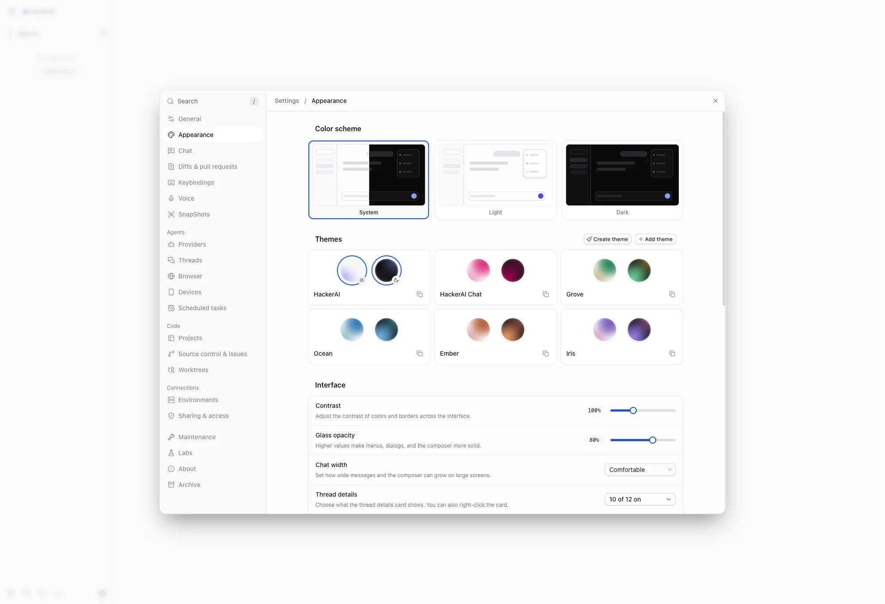

<p align="center">
  <a href="https://hackerai.sh">
    
  </a>
</p>

<h1 align="center">HackerAI</h1>

<p align="center">
  <strong>One fast app for every coding agent.</strong><br />
  Run Claude Code, Codex, Cursor, OpenCode, Grok Build, and Antigravity from one interface.<br />
  Bring your own subscription. Free and open source (MIT).
</p>

<p align="center">
  <a href="https://hackerai.sh/download"><strong>Download</strong></a> ·
  <a href="https://hackerai.sh">Website</a> ·
  <a href="https://hackerai.sh/faq">FAQ</a> ·
  <a href="./docs/README.md">Docs</a>
</p>

<p align="center">
  <a href="./LICENSE"></a>
  <a href="https://hackerai.sh/download"></a>
  <a href="https://hackerai.sh/faq"></a>
  <a href="./CONTRIBUTING.md"></a>
</p>

<p align="center">
  <a href="https://hackerai.sh">
    
  </a>
</p>

**HackerAI is the open-source control plane for coding agents.** It runs the agents already installed and signed in on your machine and gives them one fast interface on desktop, web, and phone. There is no token resale, no subscription markup, and no lock-in.

It works with Claude Code, Codex, Cursor, OpenCode, Grok Build, Antigravity, Kiro, Pi, Muse Code, fx, and any [ACP](./docs/user/providers-acp.md) agent. If an agent is set up on your computer, HackerAI can control it.

## Why HackerAI

| | |
| --- | --- |
| **Your subscriptions** | HackerAI does not resell tokens or add a markup. It drives the agents you are already signed in to. |
| **Every agent in one place** | Change models in the middle of a thread. Let Claude hand a task to Codex. Keep one workflow when you switch harnesses. |
| **Desktop, web, and phone** | One server, and every client shows the same threads. Start on your laptop and continue from a browser. |
| **Remote by default** | Run agents on any machine. Connect over your local network, Tailscale, or [HackerAI Connect](./docs/user/remote-access.md). |
| **Git built in** | Each thread can work in its own worktree. Review the diff, then commit, push, and open a pull request with one button. |
| **Fast and open** | Performance is a feature here. HackerAI is MIT licensed, self-hostable, and yours to fork. |

## Install

### Desktop app

[Download HackerAI](https://hackerai.sh/download) for macOS (`.dmg`), Windows (`.exe`), or Linux (`.AppImage` or `.deb`). Each GitHub release attaches the installers directly, and the CLI also ships to npm as `@hackerai/cli`.

### Command line

This installs the `hackerai` command. Run `hackerai` to start the server and open the web app.

```bash
curl -fsSL https://hackerai.sh/install.sh | sh
```

On Windows, in PowerShell:

```powershell
irm https://hackerai.sh/install.ps1 | iex
```

To try it once without an install, run `npx @hackerai/cli@latest`.

### Sign in to an agent

HackerAI needs one agent that is installed and signed in. For example, install [Claude Code](https://claude.com/product/claude-code) and run `claude auth login`, or install [Codex CLI](https://developers.openai.com/codex/cli) and run `codex login`.

[Provider setup](./docs/user/install.md#providers) has the steps for each agent. [Install HackerAI](./docs/user/install.md) covers nightly builds, AppImage, WSL, and NixOS.

## FAQ

- **Is HackerAI free?** Yes. It is MIT licensed, and you bring your own provider subscription or API key.
- **Which agents does it support?** Claude Code, Codex, Cursor, OpenCode, Grok Build, Antigravity, Kiro, Pi, Muse Code, fx, and any ACP agent.
- **Does my code go to HackerAI?** No. HackerAI does not train on your prompts or code. They go to the provider you chose, not to us; HackerAI Connect only sets up a tunnel between your devices.
- **Does it work on Windows?** Yes. HackerAI ships Windows 10 and 11 builds, a PowerShell installer, and WSL support for agents that need Linux.

[Read the full FAQ](https://hackerai.sh/faq) for pricing, remote access, privacy, and platform details.

## What are you selling me?

Nothing. HackerAI is free and MIT licensed. We built it because the existing agent apps did not meet our bar for performance, remote work, and openness. If we ever go the wrong direction, everything you need to fork the project is right here.

## Documentation

- [Install and first run](./docs/user/install.md)
- [Remote access from another machine](./docs/user/remote-access.md)
- [Permission modes](./docs/user/permission-modes.md)
- [Source control](./docs/user/source-control.md)
- [Connect outside agents over MCP](./docs/user/outside-agents.md)
- [FAQ](./docs/user/faq.md)

[All docs](./docs/README.md) has the full list.

## Contributing

We have limited review capacity. Small, focused fixes are the most likely to be merged. Features need an approved discussion first.

- Read [CONTRIBUTING.md](./CONTRIBUTING.md) before you report a bug or open a pull request.
- Put feature requests in the repository's Discussions tab.
- Build from source with the [development runbook](./docs/operations/development.md#first-checkout). The [architecture overview](./docs/internals/overview.md) explains how it works.

## License

[MIT](./LICENSE)
